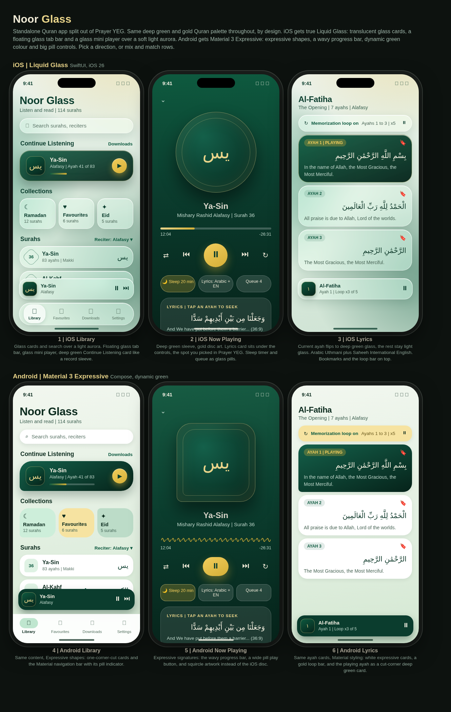
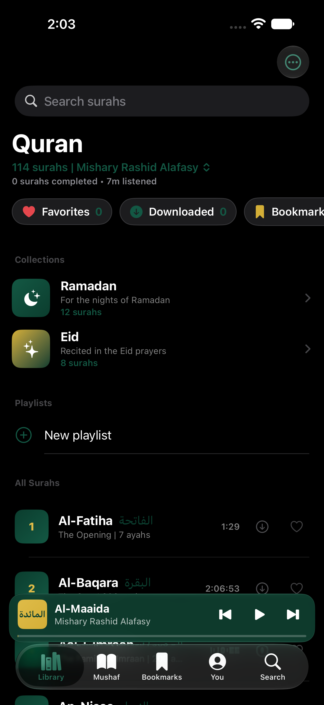
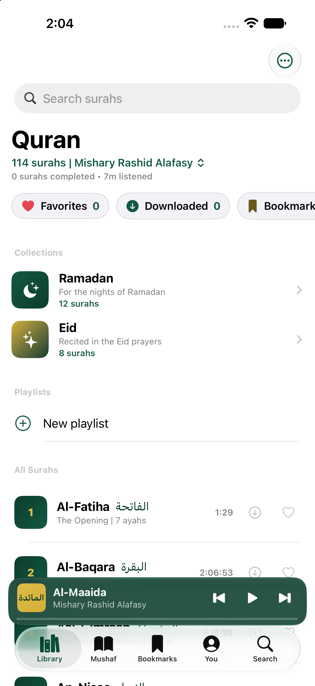
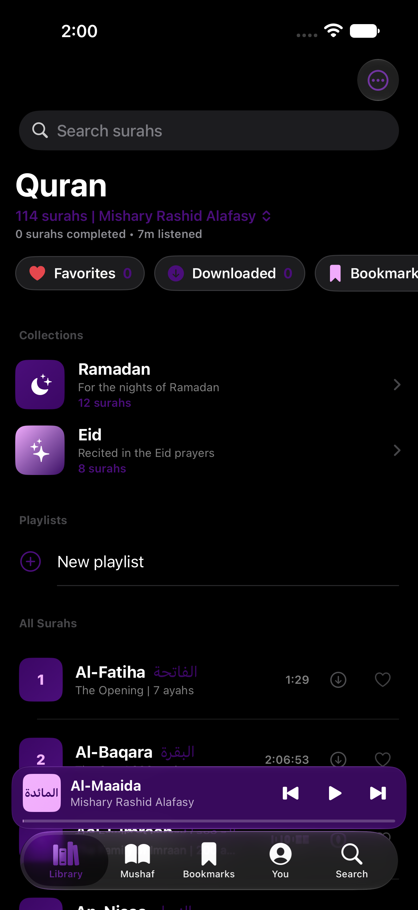
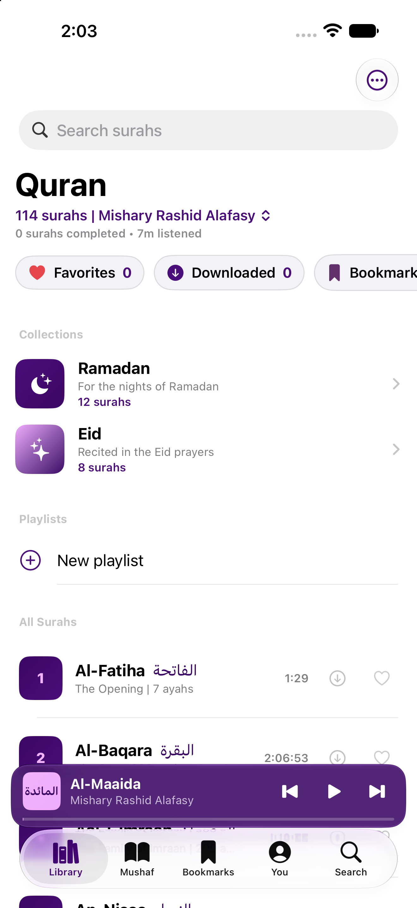

<p align="center">
  
</p>

<h1 align="center">Noor Glass</h1>

<p align="center">The complete Quran, to listen to and to read | seven reciters with per-ayah audio, the 604-page Mushaf, word-by-word meanings and tafsir, and themes on every surface.</p>

<p align="center">
  
  <a href="https://github.com/c12n/noor-glass/releases/latest"></a>
  <a href="https://github.com/c12n/noor-glass/releases"></a>
  
</p>

<p align="center">
  📖 <a href="https://testflight.apple.com/join/GdJpWTyc"><b>Join the TestFlight beta</b></a> · 📥 <a href="https://github.com/c12n/noor-glass/releases/tag/v1.1.0"><b>Download the Android APK</b></a> · 🐛 <a href="https://github.com/c12n/noor-glass/issues"><b>Report an issue</b></a>
</p>

`v1.1.0` · First public release | the Android APK is live, and the iOS public beta is in Apple's review queue.

---

## 📱 Screenshots



|  |  |  |  |
| :---: | :---: | :---: | :---: |
| **Library** | **Library, light** | **Plum Velvet** | **Plum Velvet, light** |

*Feature graphic: a design render of the interface. Screenshots: the shipped 1.0.0 app running in the iOS simulator.*

---

## 🌟 Features

| **Seven reciters**<br>Alafasy, Abdul Basit, Abdullah Basfar and Aziz Alili, plus English narration by Ibrahim Walk. Switch reciters at the top of the Library; every surah streams, or downloads for offline listening.<br> | **Sudanese recitations**<br>Noreen Mohammad Siddiq in the Ad-Duri narration and Alzain Mohammad Ahmad in Hafs Murattal | the complete 114 surahs, from mp3quran.<br> |
| :--- | :--- |
| **Per-ayah audio and lyrics**<br>Play ayah by ayah where the source supports it, with synchronized highlighting as it plays. Tap any line to seek there, and set a memorization loop for the ayahs you are learning.<br> | **The 604-page Mushaf**<br>Read page by page through the standard Madani mushaf, with juz and page navigation, ayah bookmarks and reading progress.<br> |
| **Word by word and tafsir**<br>Every word with its translation and transliteration, and Tafsir Ibn Kathir on tap for any ayah.<br> | **Search in three languages**<br>Full-text search across the Arabic text and the translations | English (Saheeh International) and French (Hamidullah).<br> |
| **Playlists and Khatmah**<br>Favourites, Ramadan and Eid collections, your own custom playlists, and a Khatmah planner that turns a finish date into a daily target with a streak to keep.<br> | **Daily Ayah widgets**<br>A new ayah every day on the Home Screen and Lock Screen (iOS) and the home screen (Android), with an optional daily reminder and a Continue Listening widget.<br> |
| **Themes on every surface**<br>8 presets with Mosque Green as the default, preset and custom accents with a contrast guard, widget colors that match the app or go their own way, and an alternate app icon per theme family. Android adds Material You dynamic color.<br> | **Yours to keep**<br>Bulk downloads per reciter, listening stats, a sleep timer with fade out, background audio and lock screen controls. No accounts, no ads, no analytics, no tracking.<br> |

Not included, by design: no CarPlay or Android Auto, and no watch apps.

---

## 🚀 Installation

### iOS

**TestFlight**

1. Open **[testflight.apple.com/join/GdJpWTyc](https://testflight.apple.com/join/GdJpWTyc)** on your iPhone or iPad.
2. Join the public beta and install **Noor Glass** from the TestFlight app.
3. Updates arrive through TestFlight automatically.

The public beta is in Apple's review queue; the link starts working as soon as the build is approved.

> [!TIP]
> The app and its widgets share data through an App Group, so open the app once after installing, then add the Daily Ayah widget from the Home Screen.

### Android

**Sideload**

1. Download `NoorGlass-1.1.0.apk` from the [v1.1.0 release](https://github.com/c12n/noor-glass/releases/tag/v1.1.0) on your phone.
2. Open the APK. If Android asks, allow **installing from unknown sources** for your browser or Files app, then tap **Install**.
3. Open the app once, then long-press your home screen to add the Daily Ayah and Continue Listening widgets.

---

## 📖 How to Use

1. **Pick a reciter:** tap the reciter name at the top of the Library to switch between the seven reciters, then tap any surah to play it.
2. **Read along:** the Mushaf tab opens the 604-page reader, and tapping a playing ayah brings up its word-by-word meanings and tafsir. In the lyrics view, tap any line to seek there.
3. **Make it yours:** pick from 8 themes, set widget colors, start a Khatmah plan, and build your own playlists.

---

## 🗺️ Roadmap

- **Public iOS beta** | the build is with Apple for review; the TestFlight link opens to everyone once it is approved.
- **App Store release** | planned once the public beta has settled.
- **More translations** | French (Hamidullah) shipped first; more languages can be added the same way.
- **More per-ayah reciters** | as the audio sources publish per-ayah files for the remaining reciters.

---

## ⚠️ Known Issues

- **Per-ayah audio coverage** follows the sources: on iOS it covers Alafasy, Abdul Basit and Basfar; on Android it is Alafasy only. Aziz Alili and the two Sudanese reciters stream per surah.
- **Word-by-word and tafsir** are fetched from the Quran.com API the first time you open them, so they need the internet once; after that they are cached on the device.
- **iOS needs iOS 26 or later** (the app is built on Liquid Glass).

---

## ❓ FAQ

**Is it free?**
Yes | free, no ads, no in-app purchases.

**Does it need the internet?**
The Quran text and the translations are bundled, so reading works fully offline. Audio streams unless you download a surah first. Word-by-word and tafsir fetch once from the Quran.com API and are then cached on the device.

**Does it collect my data?**
No accounts, no analytics, no tracking, no ads. See the Privacy section below.

**Where do the words and the voices come from?**
Every source | text, translations, reciters, page data | is credited in [CREDITS.md](CREDITS.md).

---

## 🔒 Privacy

Noor Glass does not collect analytics or usage data and shows no ads. The Quran text and translations are bundled in the app and stored on the device. Audio streams from the public CDNs credited in CREDITS.md, or plays from your own downloads. Word-by-word and tafsir data are fetched from the Quran.com API on first use and cached on the device. Nothing is linked to an identity, because there are no accounts.

---

## 🏗️ Built With

- **iOS:** SwiftUI · WidgetKit · Liquid Glass | native Xcode project
- **Android:** Flutter with Material 3 Expressive and Kotlin home-screen widgets

## 🛠️ Build It Yourself

### iOS

You need a Mac with Xcode that supports iOS 26.

```sh
git clone https://github.com/c12n/noor-glass.git
cd noor-glass

xcodebuild \
  -project ios/NoorGlass.xcodeproj \
  -scheme NoorGlass \
  -configuration Release \
  -destination 'generic/platform=iOS' \
  -archivePath build/NoorGlass.xcarchive \
  archive \
  CODE_SIGNING_ALLOWED=NO CODE_SIGNING_REQUIRED=NO CODE_SIGN_IDENTITY="" DEVELOPMENT_TEAM=""
```

That gives you an unsigned archive. To run it on your own device, open the project in Xcode instead, pick your own team under Signing & Capabilities, and Run. To make an IPA from the archive, zip the `.app` inside a `Payload` folder and rename the zip to `.ipa`, then sign it with your own certificate and provisioning profiles (or let your sideloading tool sign it).

### Android

You need Flutter (stable channel) and Java 17.

```sh
git clone https://github.com/c12n/noor-glass.git
cd noor-glass/android

flutter pub get
flutter test
flutter build apk --release
```

The APK lands at `android/build/app/outputs/flutter-apk/app-release.apk`. It is debug-signed by Flutter for local use; sign it with your own keystore before distributing it.

### GitHub Actions

One workflow lives in `.github/workflows/`:

| Workflow | Runs when | What you get |
| --- | --- | --- |
| **Build Noor Glass Android APK** | Pushes that touch `android/**`, or by hand | A release APK as the `noor-glass-apk` run artifact |

To use it on your own fork: open the **Actions** tab, pick the workflow, and press **Run workflow**, then download the artifact from the finished run.

<details>
<summary><b>Project layout</b></summary>

- `ios/` | the SwiftUI app: the app target, the widgets target, and the icon tooling
- `android/` | the Flutter app (Material 3 Expressive) with its native Kotlin widgets
- `shared-data/` | the bundled Quran data the apps are seeded from: the surah catalogue, the full text, and the narration durations
- `mockup/` | the design mockup the interface was built from

</details>

---

## Disclaimer

Noor Glass is an independent open-source project. Provided "as is", without warranty of any kind. The Quran text, translations, recitations and reference data belong to their respective sources and are credited in [CREDITS.md](CREDITS.md).

- This app is **free**. If a third party charged you for it, you may have been misled.
- No user data is collected, stored, or distributed by this repository.

## 🙏 Credits

Every source used in this app | Quran text and translations, reciters and narration, Mushaf page data, reference data, and design references | is credited in [CREDITS.md](CREDITS.md). The app itself is the work of c12n Apps, Copyright (c) 2026 c12n Apps.

## 📄 License

MIT | Copyright (c) 2026 c12n Apps. See [LICENSE](LICENSE).

> [!TIP]
> **Star the repo** to get notified about new releases directly from GitHub.
